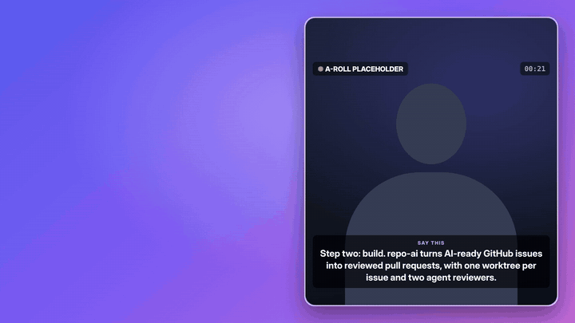

# video-ai

Agent skills for making explainer and showcase videos for software projects: talking head + animated UI cards, the style of popular AI-tools YouTube channels. Built for Claude, works with any agent that reads `SKILL.md` skills.



Everything renders from HTML with headless Chrome and ffmpeg. No Remotion license, no Adobe, no paid AI video credits.

## Skills

| Skill | What you get | Edit it in |
|---|---|---|
| [`video-basic`](skills/video-basic/SKILL.md) | One finished MP4 from a single HTML page | The HTML, then re-render |
| [`video-pro`](skills/video-pro/SKILL.md) | A layered **DaVinci Resolve** timeline (FCPXML): camera, graphics and caption tracks, a marker with the line to say on every beat, and Fusion title templates for editable text | DaVinci Resolve (free) or Final Cut |
| `video-hyperframes` *(coming)* | The same style built on [HyperFrames](https://github.com/heygen-com/hyperframes), with live preview and its block catalog | HyperFrames |

## Install

```bash
npx skills add rtorcato/video-ai
```

Or copy a folder from `skills/` into your agent's skills directory (for Claude Code: `~/.claude/skills/`). On claude.ai, zip a skill folder and upload it in the skills settings.

What the skills need on your machine:

- Python 3 and Playwright: `pip install playwright && playwright install chromium` (or let it use your installed Google Chrome)
- ffmpeg (`brew install ffmpeg`)
- For `video-pro`: [DaVinci Resolve](https://www.blackmagicdesign.com/products/davinciresolve) (the free version is enough)

## How it works

1. The agent reads your project (README, docs, brand folder) and writes a script as **beats**: one idea per scene, with the line you'll say.
2. It builds one HTML page whose `render(t)` draws any moment of the video as a pure function of time.
3. Playwright films the page frame by frame and pipes it into ffmpeg.
4. `video-pro` renders each layer separately (camera placeholder, graphics with a transparent window, captions) and writes an FCPXML timeline that DaVinci Resolve imports with every cut, position and scale in place.

Then you record yourself reading `SCRIPT.md`, swap your take in for the placeholder (Replace Clip), and edit like any other Resolve project.

## Your brand

The skills use your project's own brand when they find one (`brand/`, `DESIGN.md`, logo, mascot). To set it explicitly, add a `brand.json` (colours, fonts, logo, mascot); see [the style guide](skills/video-basic/references/style.md#brand).

## Examples

[`examples/`](examples/) has the sources of real videos made with these skills: a homelab-nut explainer (pro). The video-pro starter template is the [torcato.dev](https://torcato.dev) showcase.

## DaVinci Resolve gotchas

The ones that cost hours: Resolve ignores alpha in ffmpeg-made ProRes 4444 (so transparent layers ship as PNG sequences), it can't be handed a `.drp` from outside (import the FCPXML, then File → Export Project), and timeline thumbnails show alpha as black. More in [`resolve.md`](skills/video-pro/references/resolve.md).

## License

[MIT](LICENSE). The example mascots and brand images belong to their projects; use your own in your videos.
