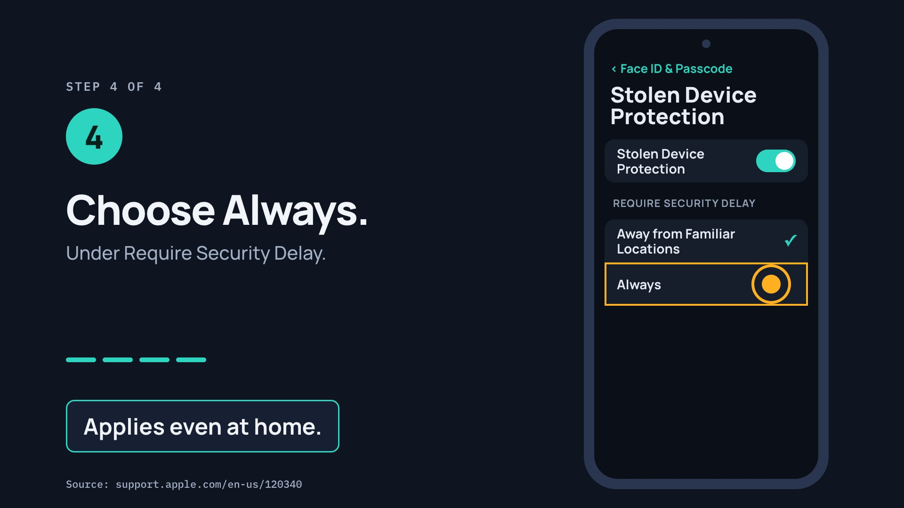

# iPhone theft protection (video-basic, Walkthrough style)

A 47-second how-to: turn on Stolen Device Protection and set the Security Delay to Always.



The phone screens are our own HTML mock UI. No Apple screenshots, logos or device art.

## Sources

Every step comes from one Apple Support article: [About Stolen Device Protection for iPhone](https://support.apple.com/en-us/120340) (iOS 17.3 or later; page dated October 22, 2026; checked 2026-11-26). The same URL is printed in the bottom-left of each video beat.

| Beat | What it says | Apple's wording |
|---|---|---|
| Intro | Needs iOS 17.3 or later; turn it on before the phone is lost | "available with iOS 17.3 or later and must be turned on before the device is lost or stolen" |
| Before you start | Two-factor authentication, passcode, Face ID or Touch ID, Significant Locations, Find My on | "you must use two-factor authentication … a device passcode; Face ID or Touch ID; and Significant Locations … You also need to have Find My turned on, and you can't turn it off while Stolen Device Protection is enabled" |
| Before you start (3) | Significant Locations path | "tap Privacy & Security, then tap Location Services … System Services … Significant Locations & Routes" |
| Steps 1 to 3 | Face ID & Passcode, enter passcode, Stolen Device Protection, turn on | "Go to Settings, then tap Face ID & Passcode. Enter your device passcode. Tap Stolen Device Protection, then turn Stolen Device Protection on or off." Also "might be turned on by default" |
| Step 1 | Touch ID models | "Face ID (or Touch ID) & Passcode" |
| Step 4 | Choose Always | "tap Stolen Device Protection and choose "Always" under Require Security Delay", which applies "even if you're in a familiar location like home or work" |
| Outro | Delay on password and passcode changes; one hour; Face ID or Touch ID again | "wait an hour and then perform an additional Face ID or Touch ID authentication" for actions such as "Change your Apple Account password" and "Change your passcode" |
| Outro | Turn it off before selling | "You should turn off Stolen Device Protection before you sell, give away, or trade in your iPhone" |

Not covered here (later how-tos): passcode strength, Find My Send Last Location, SIM PIN. The page says nothing beyond the article above.

Mock rows other than the ones Apple names (the Settings list, "Change Passcode", the "Away from Familiar Locations" label) are generic stand-ins, not instructions.

## Render

```sh
python3 render.py stills index.html 8 28     # check frames
python3 render.py video index.html out.mp4
```

`render.py` is a copy of `skills/video-basic/scripts/render.py`. For the light theme set `THEME` near the top of `index.html` to `"light"`. Needs Python 3 with `playwright`, and ffmpeg.
